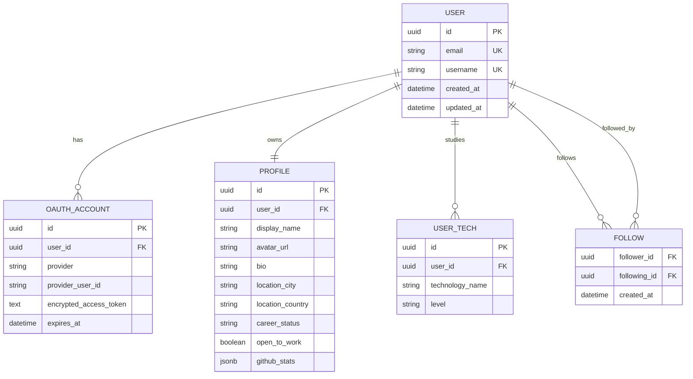

# Feature Specification: Authentification et Profil Vivant

**Feature ID**: `001-auth-profile`  
**Created**: 2026-11-14  
**Status**: Approved  
**Priority**: P1 (Prototype Core)  
**Input Reference**: [Constitution](../../.specify/memory/constitution.md), [README.md](../../README.md)

---

## 1. Overview & Business Value

Pour permettre aux développeurs d'Afrique francophone de se faire connaître sans barrière d'entrée, la plateforme propose une authentification simplifiée via **GitHub** et **GitLab**. 
Le profil de l'utilisateur est instantanément pré-rempli avec son activité réelle (langages favoris, dépôts publics phares, historique de contribution).
Pour les étudiants et débutants dont le compte GitHub est récent ou vide, un parcours d'onboarding express permet de valoriser leurs compétences en cours d'acquisition, leurs objectifs d'apprentissage et leur localisation géographique sans jamais les faire sentir illégitimes.

---

## 2. User Scenarios & Acceptance Criteria *(Mandatory)*

### User Scenario 1 : Connexion fluide d'un développeur actif
- **Acteur** : Développeur junior ou régulier avec au moins 1 projet public sur GitHub.
- **Contexte** : Découvre la plateforme pour la première fois.
- **Étapes** :
  1. Clique sur « Continuer avec GitHub ».
  2. Redirigé vers l'écran d'autorisation GitHub (permissions demandées en lecture seule).
  3. Accepte l'autorisation et est redirigé vers la plateforme.
  4. La plateforme extrait l'avatar, la bio, la liste des langages dominants et les dépôts publics récents.
  5. L'utilisateur arrive sur son profil pré-rempli et voit des suggestions de développeurs à suivre.
- **Critères d'acceptation** :
  - **Given** un compte GitHub valide avec des dépôts publics,
  - **When** l'utilisateur s'authentifie,
  - **Then** son profil est généré en moins de 3 secondes avec ses statistiques publiques, et une session sécurisée est établie.

### User Scenario 2 : Onboarding express pour un étudiant au « Profil Vide »
- **Acteur** : Aminata (étudiante en 1ère/2ème année d'informatique, 0 projet public).
- **Contexte** : S'inscrit via GitHub ou création de compte email/manuel.
- **Étapes** :
  1. Après connexion, le système détecte l'absence de dépôts publics significatifs.
  2. Un modal accueillant s'ouvre : « Bienvenue Aminata ! Personnalisons ton profil en 3 clics ».
  3. L'étudiante sélectionne :
     - Son statut : Étudiante / Débutante en reconversion.
     - Ses langages & technos d'intérêt : ex. Python, JavaScript, Flutter.
     - Sa ville / pays : ex. Ouagadougou, Burkina Faso.
     - Son objectif principal : Trouver un stage / Contribuer à un premier projet / Apprendre en communauté.
  4. Le profil affiche ces tags de manière valorisante (« En apprentissage : Python, Flutter »).
- **Critères d'acceptation** :
  - **Given** un profil sans activité GitHub,
  - **When** l'onboarding est validé,
  - **Then** le profil affiche un score de complétion de 100% avec les badges d'apprentissage sans mention péjorative de vacuité.

### User Scenario 3 : Révocation d'accès et droit à l'oubli
- **Acteur** : Utilisateur inscrit souhaitant dissocier son compte ou supprimer ses données.
- **Étapes** :
  1. L'utilisateur se rend dans « Paramètres du compte > Sécurité & Intégrations ».
  2. Clique sur « Révoquer la liaison GitHub » ou « Supprimer mon compte ».
  3. Un dialogue de confirmation récapitule les conséquences.
  4. L'utilisateur valide.
- **Critères d'acceptation** :
  - **Given** un utilisateur authentifié,
  - **When** il révoque l'accès,
  - **Then** le token OAuth chiffré est supprimé immédiatement de la base de données et les données de session sont invalidées.

---

## 3. Functional Requirements

- **FR-001 (OAuth GitHub)** : Authentification via GitHub OAuth / GitHub App avec scopes restreints (`read:user`, `user:email`).
- **FR-002 (OAuth GitLab)** : Authentification via GitLab OAuth avec scope `read_user`.
- **FR-003 (Extraction Profil)** : Extraction asynchrone des métadonnées publiques : nom d'affichage, avatar, bio, lien portfolio, top langages, dépôts mis en avant (stars/forks/commits récents).
- **FR-004 (Onboarding Junior)** : Assistant de configuration en 3 étapes pour les profils ayant moins de 2 dépôts publics.
- **FR-005 (Édition du Profil)** : Modification des informations personnalisées (titre professionnel/statut, localisation en Afrique, disponibilité pour des stages/missions, bio enrichie).
- **FR-006 (Réseau Social - Suivi)** : Possibilité de s'abonner (`Follow`) et de se désabonner (`Unfollow`) d'un autre profil.
- **FR-007 (Compteurs Sociaux)** : Affichage du nombre d'abonnés, d'abonnements, et de contributions reconnues sur le profil.
- **FR-008 (Sécurité des Tokens)** : Chiffrement symétrique AES-256-GCM des jetons d'accès OAuth en base de données.

---

## 4. Non-Functional Requirements & Constraints

- **Temps de chargement** : Affichage initial du profil utilisateur en moins de 800 ms sur réseau 3G/4G standard.
- **Mobile First** : Composants optimisés pour les écrans de 360px de large (smartphones Android répandus en Afrique de l'Ouest).
- **Sécurité** : Protection CSRF stricte sur les callbacks OAuth, cookies de session `HttpOnly`, `SameSite=Lax`, `Secure`.

---

## 5. Key Entities & Domain Models

---

## 6. Edge Cases & Clarifications

1. **GitHub API Rate Limits** : Les appels à l'API publique GitHub sont mis en cache (Redis ou table DB avec TTL de 6 heures) pour ne pas saturer le quota de requêtes par IP/App.
2. **Nom d'utilisateur déjà pris** : Si le login GitHub existe déjà sur la plateforme (cas d'un autre utilisateur ou réinscription), un suffixe numérique est proposé sans bloquer la création du compte.
3. **Refus de consentement OAuth** : Redirection vers une page explicative avec proposition de créer un profil manuel sans liaison git.
