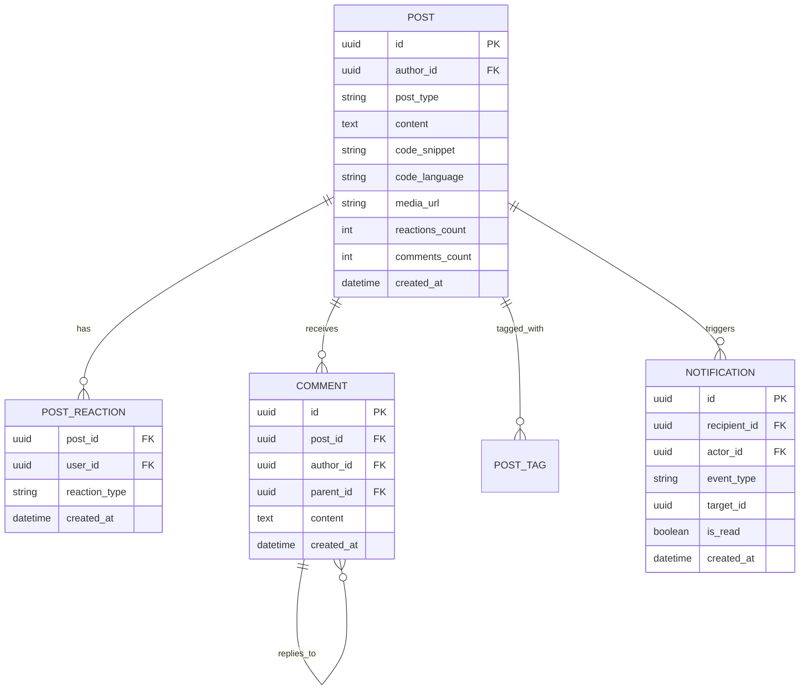

# Feature Specification: Fil Social, Publications et Interactions

**Feature ID**: `002-social-feed-posts`  
**Created**: 2026-11-14  
**Status**: Approved  
**Priority**: P1 (Prototype Core)  
**Input Reference**: [Constitution](../../.specify/memory/constitution.md), [README.md](../../README.md)

---

## 1. Overview & Business Value

La plateforme tire sa force de son **noyau social authentique**. Contrairement à des forums rigides ou des outils froids, les développeurs peuvent partager leur quotidien, leurs avancées d'apprentissage (*build in public*), commenter, s'encourager mutuellement et découvrir des pairs à proximité.
Le fil d'actualité propose un double affichage :
1. **Abonnements** : pour suivre l'activité des personnes choisies.
2. **Découverte** : pour explorer les projets et publications populaires ou émergents dans les pays cibles.

---

## 2. User Scenarios & Acceptance Criteria *(Mandatory)*

### User Scenario 1 : Publication et partage d'apprentissage
- **Acteur** : Aminata (développeuse junior).
- **Contexte** : Vient de terminer son premier tutoriel Django et veut partager sa découverte.
- **Étapes** :
  1. Se rend sur la page d'accueil / flux social.
  2. Clique sur la zone de composition de publication.
  3. Saisit son texte : « Aujourd'hui j'ai compris le fonctionnement des signaux dans Django ! 🚀 #python #django @fatou merci pour la ressource ! ».
  4. Ajoute optionnellement un extrait de code formaté en Markdown.
  5. Clique sur « Publier ».
- **Critères d'acceptation** :
  - **Given** un utilisateur connecté,
  - **When** il soumet une publication avec hashtags et mentions,
  - **Then** la publication apparaît immédiatement en tête de son fil, les hashtags sont cliquables, et l'utilisateur mentionné (@fatou) reçoit une notification.

### User Scenario 2 : Interaction, commentaires et réactions
- **Acteur** : Karim et Fatou.
- **Contexte** : Karim voit la publication d'Aminata dans l'onglet « Découverte ».
- **Étapes** :
  1. Karim clique sur l'icône « Like » (ou réaction d'encouragement).
  2. Le compteur s'incrémente instantanément (mise à jour optimiste).
  3. Karim ajoute un commentaire : « Bravo ! Prochaine étape : les QuerySets personnalisés. ».
  4. Aminata répond directement au commentaire de Karim (commentaire imbriqué).
- **Critères d'acceptation** :
  - **Given** une publication existante,
  - **When** un utilisateur réagit ou commente,
  - **Then** la réaction est enregistrée avec idempotence (un seul like par utilisateur) et la réponse est imbriquée sous le bon parent.

### User Scenario 3 : Bascule entre onglets Abonnements et Découverte
- **Acteur** : Nouvel utilisateur connecté.
- **Contexte** : Ne suit encore personne ou très peu de comptes.
- **Étapes** :
  1. Arrive sur l'onglet « Abonnements » : un message convivial suggère des personnes influentes à suivre ou propose de basculer sur « Découverte ».
  2. Bascule sur l'onglet « Découverte » : les publications les plus récentes et engageantes des développeurs de la région s'affichent avec pagination infinie.
- **Critères d'acceptation** :
  - **Given** un fil d'abonnements avec moins de 3 publications,
  - **When** l'utilisateur consulte son accueil,
  - **Then** un carrousel de profils recommandés s'affiche en bannière d'invitation.

---

## 3. Functional Requirements

- **FR-101 (Création de Publication)** : Texte riche supportant le Markdown (titres, listes, blocs de code syntaxés), emojis et images légères (jusqu'à 2 Mo).
- **FR-102 (Types de Publication)** : Distinction visuelle entre :
  - Publication simple (status / partage de veille)
  - Extrait de code technique (snippet avec langage détecté)
  - Annonce de projet / Appel à contributeurs (voir Feature 003)
  - Célébration automatique validée (voir Feature 004)
- **FR-103 (Fil d'actualité bipolaire)** :
  - Onglet `Abonnements` : flux chronologique inversé des personnes suivies.
  - Onglet `Découverte` : flux algorithmique pondéré par la fraîcheur temporelle et l'engagement (likes + commentaires) au sein de la région.
- **FR-104 (Système de Réactions / Likes)** : Like simple ou palette de 3 réactions (👍 Utile, 🚀 Inspirant, 💡 Bien vu).
- **FR-105 (Commentaires imbriqués)** : Support des commentaires à 2 niveaux de profondeur (Commentaire principal et Réponses directes).
- **FR-106 (Mentions & Hashtags)** : Autocomplétion lors de la saisie de `@nom` et indexation automatique des `#tags`.
- **FR-107 (Centre de Notifications)** : Notifications in-app temps réel ou polling court pour : nouveau follower, mention, like sur ma publication, commentaire sur ma publication.
- **FR-108 (Modération & Signalement)** : Bouton « Signaler ce contenu » avec motifs (spam, contenu offensant, non-respect de la charte).

---

## 4. Non-Functional Requirements & Constraints

- **Pagination par curseur** : Pagination performante par curseur (`createdAt` + `id`) pour éviter les décalages de flux en temps réel.
- **Taille de payload optimisée** : Moins de 50 Ko par page de 10 publications pour préserver la data mobile des utilisateurs.
- **Sanitisation Markdown / HTML** : Protection stricte contre les injections XSS via un sanitizer robuste (ex. `rehype-sanitize`).

---

## 5. Key Entities & Domain Models

---

## 6. Edge Cases & Clarifications

1. **Suppression de publication** : La suppression d'un post entraîne la suppression en cascade de ses likes et notifications associées.
2. **Commentaire sur un post supprimé** : Renvoyer une erreur 404 claire côté client sans crash de l'interface.
3. **Spam et limitation de débit (Rate Limit)** : Limiter la création de publications à 10 par heure et les commentaires à 30 par heure par utilisateur pour prévenir les bots.
