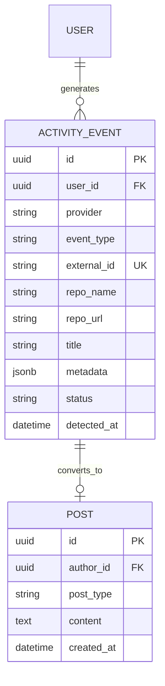

# Feature Specification: Célébration des Contributions et Activité Automatisée

**Feature ID**: `004-activity-celebrations`  
**Created**: 2026-11-14  
**Status**: Approved  
**Priority**: P2 (Prototype Core - Validation Sociale)  
**Input Reference**: [Constitution](../../.specify/memory/constitution.md), [README.md](../../README.md)

---

## 1. Overview & Business Value

L'un des défis majeurs d'un réseau social naissant est le problème du **« démarrage à vide »** (*cold start problem*) et la timidité des développeurs juniors à publier régulièrement.
Cette fonctionnalité détecte automatiquement les jalons importants de l'activité GitHub/GitLab d'un utilisateur (Pull Request acceptée/fusionnée, publication d'une nouvelle version de projet, mise en ligne d'un nouveau dépôt) et lui prépare un **brouillon de célébration prêt à l'emploi**.
Conformément à l'Article II de la Constitution, **rien n'est jamais publié sans l'accord explicite préalable de l'utilisateur**, qui conserve le contrôle total pour modifier le texte ou décliner la proposition.

---

## 2. User Scenarios & Acceptance Criteria *(Mandatory)*

### User Scenario 1 : Célébration d'une première PR acceptée
- **Acteur** : Aminata (étudiante junior).
- **Contexte** : Sa première Pull Request d'amélioration de la documentation sur le dépôt de Moussa vient d'être fusionnée sur GitHub.
- **Étapes** :
  1. Le webhook GitHub ou la synchronisation d'activité détecte l'événement : `pull_request.closed` avec `merged == true`.
  2. La plateforme génère un brouillon privé : « 🎉 Bravo Aminata ! Ta contribution sur moussa/afri-pay-utils vient d'être fusionnée ! ».
  3. Aminata reçoit une notification in-app : *« Ta contribution a été acceptée ! Partage cette réussite avec ton réseau »*.
  4. En cliquant sur la notification, une boîte de dialogue lui présente la publication pré-formatée avec la carte du projet.
  5. Aminata personnalise le message pour remercier Moussa : « Merci @moussa pour la relecture bienveillante ! Première contribution dans la boîte 🚀 ».
  6. Elle clique sur « Publier sur mon fil ».
- **Critères d'acceptation** :
  - **Given** une PR fusionnée sur GitHub liée à un compte utilisateur enregistré,
  - **When** l'événement est reçu et validé,
  - **Then** un brouillon est créé sans publication publique, et la publication n'apparaît dans le fil qu'après validation explicite par Aminata.

### User Scenario 2 : Déclinaison d'une suggestion automatique
- **Acteur** : Développeur publiant un projet expérimental qu'il ne souhaite pas mettre en avant.
- **Étapes** :
  1. L'utilisateur crée un nouveau dépôt public sur GitHub.
  2. La plateforme lui propose une suggestion : « Célébrer ton nouveau projet ».
  3. L'utilisateur clique sur « Ignorer » ou « Ne plus me suggérer pour ce dépôt ».
- **Critères d'acceptation** :
  - **Given** une suggestion de célébration en attente,
  - **When** l'utilisateur clique sur « Ignorer »,
  - **Then** le brouillon est archivé/supprimé et aucun contenu n'apparaît sur son profil ou son fil.

---

## 3. Functional Requirements

- **FR-301 (Réception d'événements Webhook)** : Endpoint d'écoute sécurisé des webhooks GitHub (`POST /api/webhooks/github`) pour les événements :
  - `pull_request` (action `closed`, `merged: true`)
  - `release` (action `published`)
  - `repository` (action `publicized` ou `created` en visibilité publique)
- **FR-302 (Vérification Cryptographique de Signature)** : Validation obligatoire du header `X-Hub-Signature-256` avec le secret webhook partagé.
- **FR-303 (Synchronisation de secours en polling)** : Vérification de l'activité publique GitHub lors de la connexion de l'utilisateur ou toutes les 24h pour les comptes n'ayant pas activé les webhooks de repo.
- **FR-304 (Générateur de Brouillons de Célébration)** : Moteur de templates générant des textes personnalisés et bienveillants adaptés à la langue de l'utilisateur.
- **FR-305 (Validation & Édition Utilisateur)** : Interface modale permettant d'éditer le texte, d'ajouter des tags ou de rejeter la publication d'un clic.
- **FR-306 (Attribution & Reconnaissance)** : La publication de type `CELEBRATION` affiche un badge distinctif et incrémente le compteur « Contributions acceptées » sur le profil du membre.

---

## 4. Non-Functional Requirements & Constraints

- **Idempotence des événements** : Enregistrement de l'identifiant unique de l'événement externe (`event_id` ou `pr_id`) pour ne jamais générer deux fois la même célébration.
- **Conformité RGPD / Souveraineté** : Règle stricte d'opt-in (zéro post automatique non consenti).
- **Temps de traitement asynchrone** : Traitement des webhooks en moins de 500 ms pour répondre immédiatement `200 OK` à GitHub/GitLab.

---

## 5. Key Entities & Domain Models

---

## 6. Edge Cases & Clarifications

1. **PR fusionnée sur un dépôt privé** : Si le dépôt est privé, aucun brouillon n'est généré afin de respecter scrupuleusement la confidentialité du code professionnel.
2. **Événements multiples simultanés** : Si un développeur fusionne 5 PRs le même jour, la plateforme regroupe intelligemment les événements ou ne propose qu'un seul résumé de célébration pour éviter de polluer le fil.
