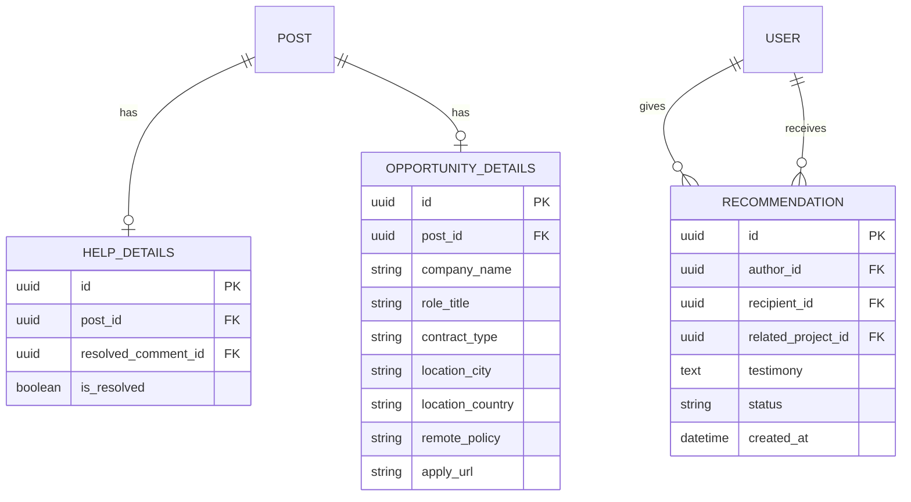

# Feature Specification: Entraide Humaine et Opportunités par Recommandation

**Feature ID**: `005-help-and-opportunities`  
**Created**: 2026-11-14  
**Status**: Approved  
**Priority**: P2 (Prototype Core - Valeur Écosystème)  
**Input Reference**: [Constitution](../../.specify/memory/constitution.md), [README.md](../../README.md)

---

## 1. Overview & Business Value

En Afrique francophone, deux réalités façonnent le marché des développeurs :
1. **L'entraide technique simple est absorbée par les IA** : Les juniors posent moins de questions élémentaires de syntaxe, mais ont un besoin crucial d'**aide humaine contextuelle** lorsqu'ils doutent d'une solution proposée par l'IA ou peinent sur l'architecture globale d'un projet réel.
2. **Les opportunités d'emploi circulent massivement par le réseau informel et la recommandation directe** : Les offres d'emploi génériques en ligne sont souvent floues ou inaccessibles. La plateforme crée un pont direct en permettant de publier des opportunités ciblées (stages, missions, premier emploi) et de valoriser des **recommandations vérifiées entre développeurs ayant réellement collaboré**.

---

## 2. User Scenarios & Acceptance Criteria *(Mandatory)*

### User Scenario 1 : Demande d'aide humaine ciblée
- **Acteur** : Aminata (bloquée sur la configuration de webhooks en local).
- **Contexte** : L'IA lui a donné des explications contradictoires sur Ngrok vs tunnels Cloudflare.
- **Étapes** :
  1. Clique sur « Nouveau post » et sélectionne le type « J'ai besoin d'aide ».
  2. Renseigne un titre clair, le contexte du problème, ce qu'elle a déjà essayé, et attache le lien de son dépôt GitHub.
  3. Sélectionne les tags : `#webhooks #node #burkina`.
  4. Publie la demande.
  5. Fatou voit le post dans le fil de découverte, lit le code et explique en commentaire la subtilité liée au port et au payload JSON brut.
  6. Aminata applique le conseil, constate que ça fonctionne, et clique sur « Marquer comme solution acceptée ».
- **Critères d'acceptation** :
  - **Given** une publication de type demande d'aide,
  - **When** l'auteur marque un commentaire comme solution,
  - **Then** le commentaire est mis en exergue visuelle (bordure verte, badge « Solution validée ») et le post passe au statut « Résolu ».

### User Scenario 2 : Publication d'une opportunité de stage
- **Acteur** : Développeur senior ou recruteur d'une startup locale.
- **Contexte** : Recherche un stagiaire ou développeur junior en React/Node.js à Ouagadougou ou en remote.
- **Étapes** :
  1. Publie un post de type « Opportunité ».
  2. Renseigne : Titre du rôle, Entreprise, Type de contrat (Stage / Mission / CDI), Localisation (ou Remote), Description des attentes, URL ou email de candidature.
  3. Le post apparaît avec un bandeau distinctif « Opportunité » dans le fil.
- **Critères d'acceptation** :
  - **Given** une opportunité publiée,
  - **When** un membre consulte le post,
  - **Then** il voit un CTA « Postuler avec mon profil » qui génère une synthèse de son profil vivant.

### User Scenario 3 : Recommandation de confiance entre pairs
- **Acteur** : Aminata demandant une recommandation à Moussa (mainteneur du projet auquel elle a contribué).
- **Étapes** :
  1. Aminata se rend sur le profil de Moussa ou depuis la page de sa contribution fusionnée.
  2. Clique sur « Demander une recommandation ».
  3. Moussa reçoit une notification privée avec le contexte de la collaboration.
  4. Moussa accepte et rédige un court témoignage : « Aminata a fait preuve d'une excellente rigueur sur la refonte de nos tests unitaires. Très bon esprit d'équipe et autonome. ».
  5. La recommandation s'affiche publiquement dans l'onglet « Recommandations » du profil vivant d'Aminata.
- **Critères d'acceptation** :
  - **Given** deux membres ayant interagi (ex. contribution ou projet partagé),
  - **When** la recommandation est rédigée et approuvée par les deux parties,
  - **Then** elle s'affiche publiquement avec un lien direct vers la contribution qui la justifie.

---

## 3. Functional Requirements

- **FR-401 (Type Post « J'ai besoin d'aide »)** :
  - Champs spécifiques : Ce que j'essaie de faire, Ce que j'ai déjà testé, Technologies concernées.
  - Attachement possible d'un projet GitHub et d'un snippet de code.
  - Action « Marquer comme solution validée » réservée à l'auteur du post.
- **FR-402 (Type Post « Opportunité »)** :
  - Métadonnées structurées : Titre, Type de contrat (`STAGE`, `FREELANCE`, `CDI`), Entreprise, Ville / Pays, Télétravail (`FULL_REMOTE`, `HYBRIDE`, `SUR_SITE`).
  - Bouton « Postuler avec mon profil » facilitant l'envoi du profil vivant de la plateforme.
- **FR-403 (Système d'Endorsement & Recommandations)** :
  - Demande formelle de recommandation avec message de contexte.
  - Validation par le rédacteur avec limitation anti-spam (seuls les comptes vérifiés peuvent recommander).
  - Témoignage affiché sur le profil du récepteur avec avatar et statut du recommandeur.
- **FR-404 (Filtre Opportunités dans le Fil)** : Filtre direct permettant aux étudiants de n'afficher que les offres de stages et opportunités débutants.

---

## 4. Non-Functional Requirements & Constraints

- **Lutte contre le travail dissimulé ou abusif** : Formulaire imposant la clarté sur la rémunération (gratification de stage, fourchette ou mention explicite « bénévolat ») pour protéger les juniors.
- **Notifications discrètes** : Un refus de recommandation n'envoie aucune notification blessante et ne pénalise en rien le compte demandeur.

---

## 5. Key Entities & Domain Models

---

## 6. Edge Cases & Clarifications

1. **Recommandations croisées de complaisance** : L'algorithme de réputation pondère les recommandations en vérifiant s'il y a un lien de collaboration vérifiable (PR acceptée ou projet partagé).
2. **Opportunités expirées** : Possibilité pour l'auteur de marquer une offre comme « Pourvue » pour qu'elle disparaisse des résultats actifs de recherche.
